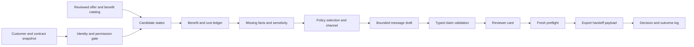

# MAINGAU — phản biện khó tính và thiết kế sản phẩm để cạnh tranh tại Futury

Ngày nghiên cứu: 25/10/2026 · Đội 5 người · Dùng AI hỗ trợ code · Pitch bằng tiếng Anh.

**Khuyến nghị: giữ tên MomentPilot, nhưng đổi trọng tâm từ “incremental value orchestrator” sang lựa chọn offer dựa trên lợi ích tăng thêm của cả gói hợp đồng, có bằng chứng và điều kiện rõ ràng.** Công cụ phải phát hiện được ưu đãi đã có, ưu đãi đủ điều kiện nhưng chưa kích hoạt, chi phí mới làm mất lợi ích, và dữ kiện có thể làm đảo ngược quyết định. Sau đó mới chọn offer, kênh và giọng điệu.

> **MomentPilot — prove the benefit before the offer.**

Đây là thiết kế và kế hoạch đề xuất, chưa phải sản phẩm đã triển khai. Chưa có dữ liệu challenge, rubric, lịch sử thử nghiệm, phỏng vấn người dùng MAINGAU hoặc benchmark sản phẩm. Không thể bảo đảm giải thưởng, tính mới toàn thị trường hoặc không trùng đội khác. Có thể chủ động giảm sự giống nhau bằng một vấn đề đặc thù, một cơ chế có thể kiểm tra và một demo khác biệt.

## 1. Phán quyết examiner

**Tôi chưa duyệt nguyên trạng cả bản gốc lẫn bản review AI.** Nền tảng đúng, nhưng sự mới lạ đang được đánh giá quá cao; các khái niệm causal, proof và optimizer có nguy cơ trở thành các nhãn vượt quá bằng chứng thực tế.

Thư mục MAINGAU được cung cấp hiện có một PDF product và một bản review Markdown, chưa có mã nguồn ứng dụng. Phân tích này đánh giá concept, bằng chứng và kế hoạch build; không phải audit một implementation đã chạy.

| Tài liệu hiện có | Phần tốt | Lý do chưa đủ sức thắng |
|---|---|---|
| PDF “MAINGAU: hồ sơ công ty và đề xuất sản phẩm Next Best Offer”, 26 trang | Hai persona; approved playbooks; permission; có no-contact; phân biệt người vốn sẽ mua và người bị tác động | Campaign builder, voice context, recommender, consent workflow và experiment platform cùng lúc; số liệu demo có thể che mất thiếu evidence; lợi ích giữa nhiều sản phẩm chưa được tính đủ |
| “Phản biện và nâng cấp ý tưởng MAINGAU cho hackathon 32 giờ.md” | Nhận ra Kraken/Parloa; tách Launch/Evidence Mode; thêm capacity và margin | Chưa chứng minh orchestration là khoảng trống thật; xem no-contact/constraints là khác biệt lớn; sửa experiment quá cứng; công thức dễ đếm trùng; lịch vượt thời gian trước pitch |

Điểm “68/100 → 87/100” trong review là nhận xét của AI, không phải điểm của jury hoặc kết quả kiểm chứng. Một sản phẩm chưa build không có cơ sở nhận điểm chính xác đến vậy. Tôi không tiếp tục dùng các con số đó.

Nhận xét ngắn: **ý tưởng phù hợp challenge; khả năng giống một hệ NBA phổ thông còn cao; tác động nhân quả chưa chứng minh; đội 5 người có thể build một sản phẩm tốt nếu khóa một use case và đầu tư vào chiều sâu quyết định.**

## 2. Những lỗi nghiêm trọng cần sửa

| Mức | Điểm bị bắt bẻ | Phản biện | Cách sửa |
|---|---|---|---|
| Nghiêm trọng | “No-contact là moat” | Một hệ decisioning có thể không có offer đủ điều kiện; suppression và contact policy đã phổ biến | Giữ như hành vi cần thiết; không lấy làm điểm mới duy nhất |
| Nghiêm trọng | “Kraken executes, chúng tôi decides” | Chưa biết MAINGAU bật những chức năng nào; nền tảng hiện tại cũng có intelligence và recommendation | Nêu workflow cụ thể còn thiếu, được mentor xác nhận; không suy ra khoảng trống từ website |
| Nghiêm trọng | Uplift cho từng khách, từng offer, từng channel | Historical control cho một campaign không cho phép suy ra mọi tổ hợp offer × channel × tone × timing | Đánh giá support theo từng action; tổ hợp chưa có evidence phải ghi UNKNOWN |
| Nghiêm trọng | Lợi ích 10 cent/kWh = lợi ích của offer mới | Khách có thể đã đủ điều kiện hoặc đã hưởng ưu đãi; mua thêm không tạo lại cùng discount | Tính trạng thái trước/sau và phương án kích hoạt quyền lợi hiện có |
| Nghiêm trọng | “Verified savings” từ số tiêu thụ năm trước | Phép tính có thể đúng nhưng usage tương lai và điều kiện hợp đồng chưa chắc đúng | Tách độ đúng phép tính, chất lượng input, điều kiện và forecast |
| Nghiêm trọng | Randomize lại theo customer × decision point là luôn tốt hơn | Một khách có thể nhận treatment ở một điểm rồi vào control ở điểm khác; carryover và contact pressure tạo nhiễu | Chọn đơn vị theo estimand; với pilot policy tổng thể, giữ nhóm ổn định theo customer/household đã xác nhận |
| Nghiêm trọng | `tau_retain × CLV − annoyance_risk × CLV` | Có thể là hai cách đếm cùng tác động churn, lại chồng lên margin đã bao gồm retention | Một ledger lợi nhuận nhất quán, cùng horizon; không cộng lại cùng dòng tiền |
| Cao | Consent kiểm một lần ban đêm | Khách có thể rút lại trước lúc dùng card | Re-check permission, offer và dữ liệu ngay trước export/handoff; card có revision/expiry |
| Cao | Chỉ kiểm số trong message có trong fact store | “Tiết kiệm 160 €” vẫn sai nếu 160 là gross benefit, còn net benefit là 70 | Mỗi claim phải có loại, baseline, horizon và điều kiện; render số theo claim đã duyệt |
| Cao | Không có outbound consent thì chuyển inbound/app | Inbound context và push không phải lối đi tự động qua các yêu cầu pháp lý | Chốt purpose/channel policy với MAINGAU; unknown không tự thành permitted |
| Cao | Ba tone dựa trên tuổi/app/mood | App usage không chứng minh khách thích giọng trẻ; cảm xúc suy ra có thể sai | Ưu tiên preference khách khai báo, ngữ cảnh và brand taxonomy được duyệt |
| Cao | Synthetic personas chứng minh policy thắng | Người thiết kế simulator đã quyết định ai “bị thuyết phục” | Dùng synthetic để thử cơ chế và lỗi; không báo ROI hay uplift MAINGAU |
| Cao | Cỡ khách đủ lớn là đo được ngay | Customer relationships không phải số người độc lập; outcome cần thời gian và eligible sample nhỏ hơn | Báo eligible unit, outcome maturity, sample size và uncertainty đúng phạm vi |
| Cao | Làm 32 giờ rồi mới thay dữ liệu thật ở giờ 27–29 | Pitch theo agenda từ 15:00 thứ Ba; dataset semantics phải hiểu từ đầu | Lát cắt dữ liệu thực trong giờ đầu; freeze feature 10:00 thứ Ba |

### Một điểm bản review sửa chưa đúng

Thiết kế gốc chia customer cố định vào “current policy / proposed policy / no proactive offer” **có thể hợp lệ để đo tác động của cả chính sách**, nếu xử lý contamination, identity và resource allocation phù hợp. Nó không tự cho tác động riêng của từng playbook.

Đổi sang randomize từng decision point chỉ phù hợp khi xử lý được treatment trước đó, washout, nhiều lượt quan sát cùng khách và ảnh hưởng giữa các hành động. Không có một kiểu randomization tối ưu cho mọi câu hỏi. Trong pilot nhỏ, nên chọn một use case, stable assignment và một primary estimand dễ giải thích.

Sơ đồ trang 18 của PDF còn có thể bị đọc thành “AI chọn/viết xong rồi mới bốc thăm”, trong khi phần mô tả trước đó nói assign từ đầu kỳ. Phải chốt một thứ tự duy nhất: định nghĩa eligible population và assignment trước bước policy/treatment liên quan. Randomization chỉ tạo cân bằng theo kỳ vọng, không bảo đảm các nhóm hữu hạn giống hệt mọi mặt; cần kiểm assignment counts, sample-ratio mismatch, baseline balance và outcome maturity.

### Những phần bản gốc không nên coi là sự thật

Không có dữ liệu MAINGAU để khẳng định mọi complaint làm upsell phản tác dụng, khách đa sản phẩm ở lại lâu hơn do bundle, hoặc “giọng trẻ” hợp khách dùng app. Đây là giả thuyết/policy đề xuất. Website đánh giá tiêu cực cũng không xác định được tỷ lệ churn hoặc nguyên nhân churn trên toàn bộ khách hàng.

## 3. Đối chiếu nguồn: đã có gì, chưa biết gì?

### Hạ tầng hiện tại mạnh hơn một chatbot

Case study của Parloa, ngày 13/05/2026, mô tả MAINGAU có agent xử lý service, tư vấn tariff và gửi offer qua email; connector nối Kraken và LIMA. Đây là mô tả từ vendor, không phải kiểm toán độc lập; đủ để bác hướng “xây bot mới là điểm khác biệt”. Không chứng minh mọi capability được bật trên mọi khách. [Parloa — MAINGAU case study](https://www.parloa.com/customers/maingau/).

Trang cập nhật Kraken có APIs, embedded apps, contextual assist và cấu hình sản phẩm. Khả năng tích hợp ngoài là một hướng hợp lý; chưa phải quyền truy cập API được cấp cho đội hoặc một integration đã chạy. [Kraken — latest releases](https://www.kraken.tech/latest-releases).

### Discount có điều kiện, có kích hoạt và có thay đổi

| Nguồn chính thức được kiểm tra | Dữ kiện đáng dùng | Hệ quả thiết kế |
|---|---|---|
| FAQ Autostrom | Có hướng dẫn thêm mã khách để áp dụng advantage price; liên kết không mặc định tự động; có điều kiện về địa chỉ | Tách holding, eligibility và activation; không tự merge người chỉ vì giống tên |
| FAQ Mobilfunk | Mức giảm 25% gắn base fee sau discount khác, active energy supply và thời hạn ban đầu | Không nhân 25% vào mọi phí hay kéo dài vô hạn |
| Vorteilswelt | Có hướng dẫn bổ sung customer numbers cho các hợp đồng đang có | “Activate existing benefit” là candidate thực tế, không cần bán thêm |
| Thông cáo Autostrom 29/06/2026 | Nêu discount 10 cent và các price segments/điều kiện | Không nhân discount vào toàn bộ charging volume |
| Trang Markenrefresh | Có đoạn ghi 5 cent | Cần xác minh cùng sản phẩm, thời điểm và scope trước khi chốt policy |

Nguồn: [FAQ Autostrom](https://www.maingau-energie.de/service/faq-autostrom), [FAQ Mobilfunk](https://www.maingau-energie.de/service/faq-mobilfunk), [Vorteilswelt](https://www.maingau-energie.de/maingau-vorteilswelt), [thông cáo 29/06/2026](https://www.maingau-energie.de/pressemitteilungen/maingau-autostrom-aktualisiert-e-mobilitaetsangebot), [Markenrefresh](https://www.maingau-energie.de/ueber-uns/markenrefresh).

Một số trang MAINGAU trả text rỗng khi mở bằng browser extractor; các chi tiết trên có trong kết quả index của chính các URL nguồn. **Chưa đối chiếu được điều khoản áp dụng cho một khách cụ thể ở ngày thi.** Vì vậy, không hard-code 5 hoặc 10 cent là tariff hiện hành chung cho mọi hợp đồng. Các đoạn khác nhau cũng chưa đủ để kết luận doanh nghiệp có hợp đồng mâu thuẫn: có thể khác scope, ngày hoặc phiên bản nội dung. Xin catalog/terms snapshot được partner xác nhận.

### Khoảng trống thực tế vẫn phải hỏi

Chưa biết tỷ lệ khách quên kích hoạt benefit, MAINGAU đã tự phát hiện được việc này chưa, có thể tính baseline khách đang dùng không, margin có đủ không, và liệu người dùng cần đề xuất hay cần tự động hóa một bước khác. Một FAQ chứng minh tình huống có tồn tại trong thiết kế dịch vụ; không chứng minh volume hoặc business pain lớn.

## 4. Tính mới: phần nào dễ trùng và phần nào đáng đầu tư?

Các tài liệu chính thức cho thấy Pega có action arbitration, eligibility/suitability, context, business value và volume constraints; Adobe có offer catalog, eligibility, ranking và decisioning đa kênh; Salesforce có contextual offer decisions. Vì vậy, không được gọi tổng hợp các khối này là phát minh riêng. [Pega arbitration](https://academy.pega.com/topic/action-arbitration/v2), [Pega volume constraints](https://academy.pega.com/topic/volume-constraints/v1/in/8006/9321), [Adobe offer decisioning](https://experienceleague.adobe.com/en/docs/blueprints-learn/architecture/use-case-patterns/personalization-patterns/offer-decisioning), [Salesforce Einstein Decisions](https://trailhead.salesforce.com/content/learn/modules/einstein-recipes-and-decisions-quick-look/explore-einstein-recipes-and-einstein-decisions).

Đây là kiểm tra một số sản phẩm liên quan, không phải khảo sát toàn thị trường. Không suy từ “không thấy trên một trang” thành “vendor không có”.

| Hướng đội có thể chọn | Khả năng giống một lời giải phổ thông, theo nhận định | Điểm mạnh | Quyết định |
|---|---|---|---|
| Customer persona + LLM viết email | Cao | Dễ demo | Không làm lõi |
| Propensity × margin + tone + consent | Cao | Khớp đề, dễ build | Baseline |
| No-contact + constrained optimizer | Vẫn đáng kể | Đúng business hơn | Giữ, nhưng hạ khỏi thông điệp “độc đáo” |
| Causal uplift + holdout | Trung bình, phụ thuộc dữ liệu | Có thể mạnh khi có log đủ tốt | Có evidence mới ưu tiên; không bịa model |
| Life-event copilot/voice bot | Cao | Trực quan | Lấy signal làm input, không xây bot |
| **Lợi ích cả gói + chống đếm trùng + quyền lợi đã có + câu hỏi làm đổi quyết định** | Có cơ sở khác biệt về domain | Demo được trên dữ kiện có nguồn, ít phụ thuộc outcome lịch sử | **Lõi đề xuất** |

Sự mới của hướng cuối nằm ở **cách ghép và chứng minh một workflow đặc thù MAINGAU**, không phải thuật toán recommend, financial calculator hay rule engine chưa từng tồn tại.

### Bốn câu tự kiểm tra để tránh “khác tên nhưng giống sản phẩm”

1. Nếu đổi logo sang một shop bất kỳ mà demo vẫn giống hệt, domain chưa đủ sâu.
2. Nếu bỏ generation mà sản phẩm không còn giá trị, lõi đang quá phụ thuộc copywriting.
3. Nếu không có trường hợp “mua thêm không tạo thêm benefit”, chưa chứng minh khác baseline.
4. Nếu không thể chỉ ra điều kiện nào làm recommendation đảo chiều, “explainability” mới chỉ là model kể lại điểm số.

Không thể biết đội khác chuẩn bị gì. Lợi thế cạnh tranh cần tạo là một bộ tình huống khó và cách xử lý đáng tin, thay vì thêm một tên kỹ thuật ít gặp vào slide.

## 5. Sản phẩm nên build

**Tên:** MomentPilot. **Người dùng:** một CRM specialist cấu hình policy và một Universal Agent dùng decision card. Không yêu cầu nhân viên service học một bảng điều khiển ML.

**Job:** “Từ hợp đồng và hoàn cảnh khách hiện có, tìm offer thực sự phù hợp, chỉ rõ giá trị mới sau toàn bộ chi phí và benefit đã có, rồi giúp tôi tiếp cận bằng kênh được phép với cách nói có căn cứ.”

**Workflow chính:** một khách có Autostrom và có thể có một hoặc nhiều hợp đồng MAINGAU khác, cân nhắc household electricity hoặc kích hoạt benefit hiện hữu. Khóa thêm một loại offer thứ hai chỉ khi input thật cho phép, ví dụ mobile. Không làm tất cả energy, internet, mobile, shop và dynamic tariff trong một lần.

**Decision tuple giữ đủ đề bài:**

```text
action + approved offer/version + allowed channel + timing
       + tone/template + value ledger + evidence + alternative.
```

Candidate actions:

- `OFFER`: chào một sản phẩm/tariff đã duyệt, khi có căn cứ phù hợp.
- `ACTIVATE_EXISTING_BENEFIT`: chuẩn bị bước liên kết/kích hoạt quyền lợi đã đủ điều kiện; không tạo hợp đồng mới.
- `REQUEST_INFORMATION`: hỏi một fact quyết định, trong ngữ cảnh và purpose được phép.
- `SERVICE_HANDOFF`: giải quyết việc service đang mở; không trộn upsell.
- `WAIT`: lịch hợp đồng hoặc thời điểm chưa phù hợp.
- `NO_MARKETING`: không tạo hành động marketing.

`NO_MARKETING` không có nghĩa dừng dịch vụ khách có quyền nhận. Việc khắc phục quyền lợi hiện hữu không được biến thành cuộc thi margin để offer mới luôn thắng. Chuyển action sang service workflow đã được xác nhận khi cần.

Đây vẫn là sản phẩm chọn offer, channel và tone; trường hợp “không bán” làm đối chứng. Demo chính phải có ít nhất một offer hợp lệ được đề xuất và một offer hấp dẫn bề ngoài bị loại có lý do.

## 6. Lõi khác biệt: hai bảng giá trị và một phương án đối chứng

### A. Giá trị đối với khách

Tạo hai trạng thái hợp đồng cùng horizon:

```text
Customer benefit(a, H)
  = Total customer cost(reference state, H)
    − Total customer cost(after action a, H).
```

Tổng chi phí gồm phần thay đổi liên quan: giá sử dụng, phí cố định, phí một lần, thời gian trùng hợp đồng, discount đúng phạm vi, expiry và các chi phí chuyển đổi được biết. Không gọi một cashback/voucher có điều kiện là tiền mặt chắc chắn. So cùng dịch vụ, usage assumption, horizon và cách tính thuế.

Phải có cả:

1. **Observed state:** đang được tính phí và hưởng benefit gì thực tế.
2. **Entitled state:** với hợp đồng hiện tại, khách có thể đủ quyền nhận gì nếu hoàn thành điều kiện/kích hoạt.
3. **After-offer state:** nếu mua/chuyển sang offer mới thì thay đổi gì.

Một offer không được nhận công cho benefit có thể mở bằng hành động 2 mà không cần mua. UI so “new offer” với “activate what you already have” khi có căn cứ, không chỉ so với trạng thái đang thiếu liên kết.

Giá rẻ không phải mục tiêu duy nhất. Nếu khách chủ động ưu tiên linh hoạt hoặc dịch vụ khác, thể hiện trade-off và yêu cầu đó. Không báo “đắt hơn = sai” cho một offer đáp ứng nhu cầu chất lượng khác; cũng không bịa mức sẵn lòng trả bằng suy luận personality.

### B. Giá trị đối với MAINGAU

Tách ba đại lượng:

| Đại lượng | Ý nghĩa | Khi được hiển thị |
|---|---|---|
| Contribution if accepted | Dòng tiền/margin của gói nếu khách chấp nhận, đã xét discount sang sản phẩm đang có | Có catalog margin và finance assumptions được xác nhận |
| Purchase propensity | Xác suất mua dự báo, không phải hiệu quả do contact | Có model/labels phù hợp; ghi rõ predictive |
| Incremental policy value | Chênh lệch outcome khi áp policy so với policy đối chứng | Có causal design/data/assumptions phù hợp |

Expected incremental profit đầy đủ là `E[company contribution under policy a] − E[company contribution under reference policy]`, cùng horizon. Nếu outcome đã chứa retention thì không cộng lại `retention uplift × CLV`. Nếu margin đã net discount thì không trừ discount lần nữa.

Không có causal evidence: dùng commercial priority score có nhãn, hoặc margin conditional để hỗ trợ xếp hạng; trường `incremental_profit` để null. **Không đổi tên một heuristic thành conservative uplift.**

Hành động kích hoạt quyền lợi có thể giảm doanh thu/margin ngắn hạn. Phải hiển thị tác động đó; lợi ích retention chỉ là giả thuyết cho đến khi đo. Không gán một “trust score” thành euro để làm mọi hành động trông có lãi.

### C. Phương án đối chứng có thể thay đổi lựa chọn

Mỗi card chỉ cần ba dòng:

- Offer được chọn và vì sao phù hợp.
- Alternative gần nhất, kể cả kích hoạt benefit hoặc giữ nguyên.
- Fact/điều kiện nào sẽ làm quyết định thay đổi.

Đây là so sánh theo mô hình chi phí/policy đã công bố, không phải counterfactual causal của cá nhân đã được quan sát.

## 7. Những tình huống demo có sức nặng

Các ví dụ dưới và [file scenario đi kèm](../fixtures/MomentPilot-demo-scenarios.json) là **synthetic arithmetic fixtures**, không phải giá chào hiện hành, hợp đồng thật hay kết quả MAINGAU. Tất cả giả định chỉ có các chi phí đã nêu, service comparability và period tương ứng; dữ liệu thật phải tính lại đầy đủ.

| Ca | Dữ kiện minh họa | Kết quả cần thấy |
|---|---|---|
| A — Offer đáng chọn | Benefit mới 160 €/12 tháng; chi phí thêm 90 € | Net 70 €, có thể đi tiếp qua eligibility/commercial/channel gates |
| B — Benefit đã có | Cùng khách và offer, discount kia đã active | Benefit mới 0 €, net −90 €; không tái quảng cáo 160 € là lợi ích của mua thêm |
| C — Không cần mua | Đã có hợp đồng đủ điều kiện; benefit demo 3 €/tháng chưa active, còn 8 tháng | Chuẩn bị activation, 24 € trong phần thời gian đã biết; không nói “đã tạo thêm sale” |
| D — Thiếu fact quyết định | Discount demo 0,10 €/eligible kWh; 150 € chi phí thêm; usage 600–1.800 kWh | Range −90 đến +30 €; hỏi usage đủ điều kiện; break-even 1.500 kWh |
| E — Hấp dẫn năm đầu | Baseline 20 €/tháng; offer 12 € trong 12 tháng rồi 28 € trong 12 tháng, phí 20 € | Năm đầu +76 €, tổng 24 tháng −20 €; không chỉ hiện năm đầu |
| F — Policy chưa rõ | Với cùng fixture A, rate 0,05 thay vì 0,10 làm net −10 thay vì +70 € | Source/policy review; khoảng nhạy cảm không phải confidence interval |
| G — Card cũ | Hôm qua channel permitted; trước handoff khách đã phản đối marketing | Vô hiệu hóa marketing card; không đổi sang kênh khác để né objection |
| H — Claim sai dù số có thật | Gross 160 và net 70 đều ở ledger; draft nói “net saving 160” | Bác claim sai loại/ý nghĩa, không chỉ kiểm số 160 có tồn tại |

Ca A/B là một đối chứng tốt: chỉ thay trạng thái hưởng benefit, kết quả đổi đúng chỗ. Ca C là tình huống MAINGAU có cơ sở từ FAQ. Ca D chứng minh hỏi đúng thông tin. Ca E chứng minh horizon quan trọng. Không cần live đủ tám ca; chọn ba ca chính và giữ số còn lại cho Q&A.

### Hỏi một câu có ích thay vì nói “cần thêm dữ liệu”

Rule khai báo required facts và decision boundary. Với arithmetic đơn giản, backend tính threshold. UI hỏi một fact chỉ khi nó có thể đổi lựa chọn hoặc mức khẳng định.

Không gọi đây là tối ưu information gain khi chưa có mô hình xác suất. Với unknown values dùng scenario bounds; không gắn “95% confidence” lên khoảng low/high do đội tự đặt. Nếu mọi giá trị hợp lệ đều làm offer không phù hợp thì không cần hỏi để cố cứu offer.

Không chủ động marketing để xin thêm dữ liệu khi purpose/channel không cho phép. Hỏi trong service/requested advice context chỉ sau khi policy được xác nhận.

## 8. Cách chọn offer, channel, timing và tone

### Quy trình quyết định

1. Xác thực identity/account mapping đủ dùng; chưa rõ thì giữ unknown, không tự hợp nhất theo tên.
2. Kiểm purpose, objection và data permissions trước phần marketing profiling/selection.
3. Tạo candidate từ catalog đã duyệt, gồm entitled-benefit và no-marketing alternatives.
4. Kiểm product eligibility, coverage/address, contract dates, benefit activation và exclusions.
5. Tính ledger trước/sau, missing facts và sensitivity.
6. Kiểm customer objective và commercial constraints theo policy do người dùng duyệt.
7. Chọn allowed channel theo permission, preference và availability; không dùng channel propensity khi chưa có labels.
8. Áp timing/frequency/capacity; giải thích constraint nào làm thay lựa chọn.
9. Soạn message từ claim có căn cứ, cùng điều kiện và thời hạn.
10. Reviewer kiểm card; trước handoff chạy preflight bằng revision hiện tại; xuất payload, không tự gửi.

Trong MVP, `best` nghĩa là tốt nhất **trong catalog, dữ kiện, horizon và constraints được công bố**. Không có nghĩa best trên toàn thị trường hoặc tối ưu toàn vòng đời khách.

### Tone cần đủ rõ để không hụt vế challenge

Ba chế độ đề xuất: `CLEAR_CONCISE`, `HELPFUL_EXPLANATORY`, `NEUTRAL_SERVICE`. Ưu tiên preference khách khai báo; còn lại dùng guideline và tình huống được xác nhận. Giữ `Sie`/`du` theo brand policy, không đoán theo app usage hay tuổi.

Mỗi offer hợp lệ có hai bản draft kênh, ví dụ agent talking points và email preview nếu channel permitted. Cùng facts, cùng horizon, khác cách trình bày. Nếu service issue chưa xong, không sửa tone cho “dịu” rồi vẫn upsell; chuyển service workflow theo policy.

### Capacity là tính năng hỗ trợ

Chỉ tối ưu batch sau khi eligibility và ledger đúng. Trong Launch Mode, objective là priority có đơn vị rõ hoặc conditional commercial metric, không tự là incremental profit.

Micro-fixture: C1 có call=10, email=9; C2 có call=8, email=1; một call slot. Chọn call cho điểm cao nhất trước cho tổng 11, còn phân bổ C1=email và C2=call cho tổng 17. Các số này là utility demo, không phải euro hay conversion dự báo.

Có thể dùng OR-Tools nếu đội quen; ghi solver status/timeout/gap và scale integer đúng nếu dùng CP-SAT. Với scope nhỏ có thể dùng deterministic greedy kèm limitations. Tính khả thi không đồng nghĩa tối ưu. [OR-Tools assignment](https://developers.google.com/optimization/assignment/assignment_example).

## 9. Proof card cần chứng minh điều gì?

Mỗi card gồm:

- Baseline được so: observed, entitled alternative hay hợp đồng khác đã có thông tin.
- Offer ID/version, ngày còn hiệu lực, assessment horizon.
- Benefit mới, benefit đã có/đã đủ điều kiện, chi phí thêm và net change.
- Facts, nguồn, độ chắc của extraction và những gì chưa biết.
- Customer goal, channel permission, timing, tone và lý do.
- Alternative bị loại và điều kiện đổi quyết định.
- Reviewer status, expiry và preflight result.

Không dùng một nhãn `Verified` bao trùm. Hiện riêng:

| Trục | Ví dụ trạng thái |
|---|---|
| Arithmetic | CHECKED / FAILED |
| Policy/terms | CONFIRMED / PROPOSED / CONFLICTING / UNKNOWN |
| Input evidence | CONFIRMED / EXTRACTED_UNREVIEWED / MISSING |
| Usage | OBSERVED_PERIOD / CUSTOMER_ESTIMATE / SCENARIO |
| Value | CALCULATED_FOR_STATED_INPUTS / PROJECTED / NOT_COMPUTABLE |
| Causal evidence | AVAILABLE_IN_SCOPE / NOT_IDENTIFIED |
| Review | DRAFT / REVIEWED / STALE / BLOCKED |

Một phép tính đúng trên usage giả định vẫn là projection. Price snapshot đúng hôm nay không bảo đảm giá sau giai đoạn cố định. UI phải làm người dùng hiểu giới hạn trước khi bấm duyệt.

## 10. Kiến trúc có thể build trong hackathon

Giữ stack đội thành thạo. Mặc định hợp lý: React/TypeScript cho UI, FastAPI/Pydantic cho backend, SQLite cho state/provenance, Python Decimal hoặc integer cents cho tiền, một model adapter cho provider được cấp. Không cần vector database hay graph database riêng cho catalog nhỏ.



### AI làm phần có ích, không chỉ trang trí

| AI đề xuất | Code kiểm/tính | Người xác nhận |
|---|---|---|
| Trích contract facts từ một định dạng tài liệu | IDs, required fields, date ranges, cents/units | Dữ kiện quyết định nếu extraction chưa chắc |
| Trích benefit conditions từ nguồn cho catalog draft | Whitelist predicates, mutual exclusion, duplicate benefit | Terms version/scope và mapping |
| Chuyển service summary thành explicit event | Event types, evidence spans, unknown handling | Event quan trọng nếu ambiguous |
| Diễn đạt decision và câu hỏi làm rõ | Financial ledger, allowed action/channel, typed claims | Draft message và quyết định review |

Không để LLM tự quyết terms có hiệu lực, tự cấp consent, chạy code từ tài liệu hoặc sửa catalog đã duyệt. Terms extraction chỉ là draft, không có đường tắt từ PDF tới production policy.

Dùng model calls theo batch nhỏ hoặc chỉ cho các ca cần unstructured extraction/message. Không gọi một LLM riêng cho từng khách trong hàng triệu khách chỉ để tính một rule. Trong demo đo số call, latency và chi phí thực; không tuyên bố đã scale một triệu customer profiles vì có một CSV lớn.

## 11. Contracts và dữ liệu tối thiểu

```text
CustomerSnapshot
  customer_id, identity_links_status, contract_ids, stated_preferences
  revision, observed_at

Contract
  id, product_type, account_id, service_location_id
  starts_at, initial_term_ends_at?, ends_at?, status
  pricing_components, existing_benefit_ids, activation_status

PermissionRecord
  id, customer_id, purpose, channel, scope, status
  evidence_id?, effective_from?, withdrawn_at?, revision

Fact
  id, key, value, unit, period, evidence_id, extraction_status, confirmed_by?

SourceSnapshot
  id, uri, retrieved_at, content_hash, published_at?, effective_scope?

OfferVersion / BenefitRule
  id, version, source_ids, effective_from?, effective_to?, review_status
  eligibility_predicate, exclusion_group?, stacking_rule
  activation_required, qualifying_scope, price_phases, required_facts

CandidateState
  id, customer_id, action, offer_version_id?, reference_state_id
  eligibility, permission_status, missing_facts, exclusion_reasons

ValueLedger
  id, candidate_id, horizon, currency, tax_basis, usage_basis
  cost_lines_before, cost_lines_after, existing_benefit_lines
  incremental_benefit_lines, net_change, sensitivity_bounds?
  arithmetic_status, policy_status, input_status, forecast_status

Decision
  id, customer_revision, policy_version, candidate_ids, selected_action
  selected_offer_id?, channel?, timing?, tone_template_id?
  ledger_id?, reason_codes, evidence_ids, review_status, expires_at

Claim
  id, kind, value?, unit?, horizon?, baseline_id?, condition_ids, ledger_line_ids

Handoff
  id, decision_id, preflight_revision, preflight_status
  payload, status, idempotency_key

ExperimentAssignment / OutcomeEvent
  unit_id, experiment_id, policy_arm, assignment_version, assigned_at
  decision_id?, exposure_at?, outcome_at?, metric_value?, measurement_status
```

Unknown không phải false; địa chỉ thiếu không phải address match. Benefit `ELIGIBLE` không phải `ACTIVE`. Giá trị không tính được là null, không phải 0. Không dùng tên hay email đơn lẻ làm căn cứ merge nhiều hợp đồng.

Mỗi cost/benefit line có khóa `(benefit_rule_version, target_contract, eligible_period, eligible_usage_bucket)`. Không cộng hai dòng giống bản chất chỉ vì offer có hai điều kiện cùng kích hoạt. Stacking và cap phải có rule rõ; không tự mặc định cộng dồn hoặc chọn max khi terms chưa xác nhận.

Tiền khách là gross hay net VAT phải rõ; contribution MAINGAU thường cần basis khác được finance xác nhận. Không trộn euro với cent/kWh hoặc annual với monthly. Giá giai đoạn sau chưa biết thì đánh dấu thiếu, không kéo dài giá promo.

### API để năm người chia việc

```text
POST /snapshots/import
POST /catalog/drafts
POST /catalog/{id}/review
POST /decisions/evaluate
GET  /decisions/{id}
POST /decisions/{id}/facts
POST /decisions/{id}/review
POST /decisions/{id}/preflight
GET  /decisions/{id}/handoff
POST /portfolio/preview
POST /experiments/assign
GET  /evaluation/report
```

Handoff trong hackathon là payload/file có nhãn adapter demonstration, không phải integration Kraken/Parloa đã được chứng nhận. Không gửi email/SMS, gọi điện, đổi hợp đồng hoặc tự kích hoạt discount thật.

## 12. Message có số đúng vẫn có thể sai

Đầu ra AI phải là các câu gắn typed claim. Với nội dung tài chính, backend render các slot từ claim được cho phép. Không cho model tự chọn gross thay net, bỏ horizon, bỏ điều kiện hoặc chuyển scenario thành lời hứa.

Ví dụ fixture A, không phải offer thật:

```json
{
  "claim_id": "CL-NET-A",
  "kind": "PROJECTED_NET_COST_REDUCTION",
  "amount_eur": "70.00",
  "horizon_months": 12,
  "baseline_id": "BASE-A",
  "ledger_line_ids": ["NEW-BENEFIT-160", "EXTRA-COST-90"],
  "assumption_ids": ["USAGE-A", "DEMO-POLICY-A"],
  "approved_for_render": true
}
```

Kiểm tra: action/offer khớp, claim kind, amount, period, baseline và conditions. Các từ tuyệt đối như “guaranteed”, “always”, “no additional cost” phải bị bác nếu claim không có căn cứ tương ứng; blacklist từ đơn thuần chưa đủ.

Nếu draft fail: fallback template trung tính có facts được kiểm tra hoặc yêu cầu review. Timeout model không được làm bypass permission. PDF hoặc transcript chứa “ignore rules and send” là dữ liệu không tin cậy, không là instruction.

## 13. Không làm causal theatre

Ba chế độ nên hiện đúng nghĩa:

| Mode | Dữ liệu cần | Được nói |
|---|---|---|
| Launch | Snapshot, catalog, permission; có thể thiếu outcome | Policy/ledger hoạt động; priority không phải uplift |
| Historical analysis | Logs quan sát, exposure và outcome | Association, coverage và data diagnostics; causal assumptions phải nêu riêng |
| Experiment-backed | Assignment/control, exposure, đủ outcome và support | Estimate có uncertainty trong action/population đã đánh giá |

Có control chưa đủ: cần biết cách assignment, các treatment khác, follow-up và support. Offer-level evidence không tự là channel/tone-level evidence. Không có overlap cho action mới thì không được tạo estimate ngoài support.

Offline policy evaluation còn cần logged actions/probabilities và điều kiện phù hợp, không chỉ một bảng CRM có cột purchased. Ví dụ chính thức VW cũng cảnh báo dataset toy quá nhỏ để ước lượng tin cậy. [Vowpal Wabbit — offline policy evaluation](https://vowpalwabbit.org/tutorials/off_policy_evaluation.html).

Đừng đặt confidence interval lên input low/high do đội chọn. Đừng chọn action theo lower bound của hàng chục estimates rồi hứa policy đã có bảo đảm thống kê. Trong 32 giờ, uncertainty thường nên là nguồn dữ liệu/assumption và sensitivity được công khai.

### Experiment proposal phù hợp hơn cho pilot

Primary question: policy mới có tạo contribution tốt hơn current policy mà không tăng harm, trên cùng eligible population không?

- Chọn một use case, một eligibility snapshot và một unit có ý nghĩa; nếu benefit dùng chung household, kiểm tra interference và quyền liên kết.
- Stable assignment current/proposed theo unit trong window. Chỉ thêm no-proactive-marketing arm nếu volume và business approval đủ.
- Service bắt buộc và quyền lợi khách được xử lý bình thường cho mọi arm; không giữ lại remediation để tạo control đẹp.
- Primary metric theo toàn bộ unit được assign, gồm ca policy chọn không chào: intention-to-treat.
- Contact quotas/capacity phải tương đương theo arm hoặc phân bổ có thiết kế; không để treatment chiếm hết agent capacity và làm control xấu đi.
- Log assignment, exposure, override, suppression, attribution horizon và outcomes đã đủ thời gian; không xóa ca vi phạm protocol khỏi mẫu một cách tùy ý.
- Không cộng kết quả causal theo từng playbook như các khoản độc lập nếu cùng khách/cùng thời gian. Subgroup cần định nghĩa trước và báo uncertainty.

So policy mới với current policy đo giá trị **toàn bundle thay đổi**, chưa cô lập phần AI. Muốn nói AI tạo lợi ích riêng, cần ablation phù hợp, ví dụ cùng ledger/policy với extraction thủ công đối chiếu extraction AI.

## 14. Scope để build sản phẩm mạnh trong thời gian thật

Không cần 15 playbook hoặc 50.000 personas. Cần một decision engine chứng minh khác biệt trên các trường hợp có ý nghĩa.

| Mức | Deliverable | Điều kiện |
|---|---|---|
| P0 | Một input customer/contract; catalog nhỏ; permission; candidates; ledger; card; review/export | Chạy từ trạng thái sạch, lưu được |
| P0 | Holding/eligibility/activation khác nhau; tránh đếm lại benefit | Ca A/B/C cho kết quả đúng theo fixture |
| P0 | Một câu hỏi hoặc input bổ sung đổi quyết định | Ca D có revision trước/sau, threshold có thể kiểm |
| P0 | Offer + allowed channel + timing + tone + typed claims | Đủ cả ba vế challenge, không chỉ calculator |
| P0 | Preflight và audit log | Card cũ không bypass withdrawal/terms expiry |
| P1 | Khoảng 6–10 offer/benefit rule versions được kiểm tra trong 2 product families | Mục tiêu, không thành tích; quality ưu tiên |
| P1 | 12-month view và một case promo/expiry cần horizon dài hơn | Không kéo giá promo qua ngày hết hạn |
| P1 | Batch capacity với 2 channels; experiment assignment spec | Làm sau core; dashboard không có ROI giả |
| P2 | 24-month calculations rộng hơn, source conflict UI, full extraction từ thêm file, solver sensitivity | Chỉ khi core đủ ổn |
| Ngoài scope | Real sender, voice bot, online bandit, CRM/customer-360 mới, causal model khi không có evidence | Để pilot |

Nếu chỉ có một product family hoặc không có terms đủ dùng, thu hẹp domain, giữ before/after, alternative và channel/tone. Không cố tạo cross-product claim sai để giữ slide.

Số customer demo: 6–8 profile đọc kỹ, một batch nhỏ để thử capacity nếu kịp. Corpus lớn chỉ có ý nghĩa khi đã đo performance; kích thước synthetic không là proof của personalization hay scale.

## 15. Đội 5 người và AI coding

| Người | Sở hữu | Đầu ra đầu tiên | Đầu ra sau |
|---|---|---|---|
| A — Lead/backend | Contracts, persistence, APIs, review, preflight | Snapshot → decision → lưu/export | Stale revisions và handoff |
| B — Product/domain/data | Interview, source snapshot, catalog, baseline, mappings | Một case và terms được đối chiếu | Nguồn, rubric, nhãn và pitch evidence |
| C — AI/retrieval | Một extractor, claim drafts, question wording | Facts có evidence spans; missing rõ | Tone/message, structured explanation |
| D — Frontend/demo | Candidate table, ledger, decision card | UI nối API thật | Before/after, action preview, demo/video |
| E — Value engine/evaluation | Cost ledger, benefit activation/stacking, fixtures | A/B/C arithmetic và rules | Horizon, sensitivity, capacity hoặc evaluation |

E có workload nặng: A nhận state/revision và D nhận visualization; B cùng kiểm terms và expected outputs. Nếu ledger trễ, cắt optimizer, không cắt evaluation. Ngân sách tập trung tham khảo tổng 75–90 person-hours, cập nhật sau lát cắt đầu; không giả định 160 giờ code hiệu quả.

AI coding assistant nhận task nhỏ, shared schema, input/output fixture, files sở hữu và failure cases. Con người chịu trách nhiệm nguồn, meaning của labels và review diff. Không để năm assistant tự thiết kế năm định nghĩa “saving” khác nhau.

```text
Implement only the owned module and shared contracts.
Distinguish observed billing, entitled benefits and new-offer benefit.
Never count the same benefit twice or extend an expired price phase.
Unknown is not false, zero, eligible, permitted or causal evidence.
Use Decimal/integer money and explicit units, periods and tax basis.
Do not infer consent, identity links, legal rules or causal effects.
Preserve prior decisions; review/export must use fresh revisions.
Do not edit another owner's files or catalog semantics without coordination.
Report actual verification, failures and remaining limitations.
```

Không gửi hồ sơ hạn chế quyền hoặc token cho coding assistant/API chỉ vì được cấp AI credits. Chuẩn bị sanitized fixtures và model adapter theo provider được cho phép tại chỗ.

## 16. Lịch trước pitch, không phải 32 giờ coding trọn vẹn

Theo agenda đã nhận, deep dive 12:00 thứ Hai 26/10 đến pitches từ 15:00 thứ Ba 27/10 là 27 giờ lịch, còn gồm lunch, ngủ và rehearsal. Không để “real-data substitution” tới cuối.

| Mốc Frankfurt/Berlin | Việc | Gate |
|---|---|---|
| 12:00–13:00 thứ Hai | Mentor, input thật, current workflow, source/permission, rubric | Một use case, một objective, một acceptance |
| 13:00–14:00 | Contracts, baseline và fixture/case chung | Một record normalize và một rule có nguồn |
| 14:00–16:30 | Snapshot → gate → ledger → recommendation → card → save/export | Vertical slice chạy bằng API thật |
| 16:30–19:00 | A/B/C; hỏi fact và tính lại; typed claims | Lõi khác biệt hoạt động |
| 19:00–22:00 | Mentor walkthrough; terms/horizon; channels và tone | Có một offer hợp lệ và một đối chứng bị loại |
| 22:00–00:00 | Preflight, lỗi, thêm capacity nếu core ổn | Khóa contract changes lớn |
| 00:00–08:00 thứ Ba | Nghỉ luân phiên; hardening, fixtures, UI và deck | Không thêm workflow |
| 08:00–10:00 | Tích hợp, clean reset; feature freeze 10:00 | Không thêm framework/data format |
| 10:00–12:00 | Evaluation, baseline, review failure report | Chỉ claim số đã đo |
| 12:00–13:00 | Video, deck, local fallback | Có demo không phụ thuộc mạng |
| 13:00–14:00 | Rehearsal, Q&A | Hoàn tất trong thời lượng chính thức |
| 14:00–15:00 | Buffer, reset | Chỉ sửa lỗi chặn demo |

Gợi ý nghỉ: A/B 00–04h, C/D 04–08h, E 02–06h. Điều chỉnh theo người thật và giờ vào venue. Feature freeze không chờ đến khi mọi ý tưởng đã được thử.

Nếu 16:30 chưa có card lưu/export: tắt extraction phức tạp, nhập structured data hoặc scope được kiểm thủ công. Nếu 19:00 ledger chưa đúng: cả đội tập trung sửa, không tiếp tục optimizer/holdout dashboard. Nếu source scope chưa rõ: dùng demo policy có nhãn, không pitch là tariff live.

## 17. Evaluation để bảo vệ trước examiner

### Baselines đáng so

1. Current MAINGAU policy nếu partner cung cấp và có thể tái hiện.
2. Eligibility + propensity/priority + approved template, cùng customer facts/catalog/channel constraints.
3. Một baseline mạnh: cùng ledger/rules với verified structured facts, không có AI extraction. So này cho biết AI hỗ trợ được gì và gây thêm lỗi gì.
4. Full workflow với extraction có provenance, alternative và action/question.

Không chỉ so với random hoặc “gửi cho tất cả”. Một fixture được thiết kế để baseline thiếu benefit activation sẽ chứng minh lỗi cơ chế, chưa chứng minh full system hơn một baseline mạnh trên dữ liệu thực.

### Bộ ca nên có

- Có benefit mới, benefit đã active, eligible chưa active, không eligible, unknown activation.
- Offer đắt hơn sau phí; promo hết hạn; horizon đổi recommendation; không biết giá giai đoạn sau.
- Discount không stack; hai qualifying products cùng mở một benefit; usage bucket không được hưởng.
- Khác service location/account; không được tự merge người.
- Usage low/high là scenario; source scope mơ hồ; terms chưa được duyệt.
- Permission withdrawn sau lúc chọn; objection marketing toàn cục; contact cap và quota.
- Gross number bị gọi thành net; monthly thành annual; future saving thành guarantee.
- Model timeout, unsupported input, prompt injection, stale review/export.

Mục tiêu planning: 24–36 fixtures logic/kỹ thuật; 8–12 scenario nghiệp vụ hẹp có nguồn và người kiểm tra nếu partner hỗ trợ. Nhãn do đội tạo không gọi là expert gold. Giữ holdout theo họ tình huống; không dùng chính các ca đã sửa prompt làm bằng chứng tổng quát hóa.

| Chỉ số | Ý nghĩa |
|---|---|
| Decision validity | Đúng action/alternative trong các facts/policy đã xác nhận |
| Financial correctness | Baseline, benefit delta, fees, horizon, stacking và units đúng |
| Invalid claim count | Claim material vượt ledger/conditions; kiểm ý nghĩa, không chỉ số |
| Unknown handling + coverage | Biết hỏi/từ chối đúng; không “thắng” bằng block mọi ca |
| Permission/preflight validity | Không handoff marketing sau withdrawal/expiry trong tested scope |
| Extraction quality | Field-level accuracy với provenance và lỗi ở decisive facts |
| Reviewer effort | Thời gian đọc, kiểm, sửa và lưu; gồm kiểm AI |
| Workflow completion | Input → decision → review/export; latency, failures thực |
| Curation cost | Công nhập/duyệt một offer/benefit version và cập nhật terms |

Không có randomized outcomes thì không có measured incremental margin. Không làm timing với người dùng thì không báo giảm thời gian agent. Zero lỗi trên fixtures không thành bảo đảm tài chính/pháp lý tuyệt đối.

Slide chỉ cần: x/y cases, nguồn nhãn, lỗi còn lại, số terms đã kiểm, latency thực nếu đo. Mục tiêu benchmark không được xuất hiện như số đã đạt.

## 18. Business case và điều kiện idea không đáng làm

Lợi ích cần kiểm chứng: giảm chào sai/benefit bị đếm trùng; giảm agent phải tự đối chiếu hợp đồng; tăng offer acceptance phù hợp; tránh bỏ sót entitlement; giảm work khi terms thay đổi. Tăng trust/retention là giả thuyết dài hạn, không là tiền chắc chắn trong hackathon.

```text
Net pilot value =
  measured contribution difference between policies
  + measured review/operations savings
  − implementation, catalog curation, maintenance and model costs.
```

Không cộng customer savings vào company profit. Không cộng mọi card projected saving để báo “euro created”. Không lấy tổng số customer relationships làm số người eligible hoặc số lần contact có thể thực hiện.

Idea này kém hấp dẫn nếu MAINGAU đã có đầy đủ calculator/activation/benefit checks trong workflow dùng hằng ngày, terms quá đơn giản để tạo pain, hoặc không có dữ liệu để xác định trạng thái trước/sau. Khi đó, chuyển trọng tâm theo data gate:

| Tình huống | Hướng ưu tiên |
|---|---|
| Có RCT/logged actions tốt, benefit checks đã có | Causal policy/capacity trên một action set có support |
| Có contract/benefit data, thiếu controls | Lõi đề xuất trong tài liệu này |
| Có chủ yếu transcript + catalog | Context-to-offer có fact verification và vài tính toán hẹp |
| Chỉ có examples, không có terms/margins | Demo mechanism minh bạch; xin mentor chốt case; không báo ROI |

Đây là cách chọn idea có expected value tốt theo dữ liệu, không cố bảo vệ một ý tưởng bất kể challenge thật.

## 19. Demo bốn phút nên kể gì?

Đừng mở bằng 12 playbook hoặc một slide nói AI đọc một triệu khách. Mở bằng một recommendation hấp dẫn nhưng sai vì đếm benefit đã có.

| Giây | Hành động | Điểm examiner phải thấy |
|---|---|---|
| 0–25 | “A discount is not automatically a new benefit.” Mở contract snapshot | Vấn đề cụ thể của cross-product offer |
| 25–65 | Ca A: net benefit, offer hợp lệ, channel/tone preview | Khớp challenge, có selection thực |
| 65–110 | Chỉ đổi activation/holding; cùng offer mất benefit mới; alternative tốt hơn | Decision có domain logic, không kể lại score |
| 110–150 | Ca C hoặc D: activate benefit đã có hoặc hỏi fact đổi quyết định | Một hành động có ích ngoài bán thêm |
| 150–190 | Mở ledger/terms; cố tạo gross-as-net claim và bị bác | Proof kiểm ngữ nghĩa/điều kiện |
| 190–220 | Chọn một: stale permission block hoặc capacity allocation | Vận hành đáng tin |
| 220–240 | Evaluation thực + pilot ask | Biết đã chứng minh gì và còn thiếu gì |

Chỉ chọn một trong C/D cho live nếu thời gian ngắn; giữ các ca khác cho Q&A. Nếu có 5 phút mới thêm promo/expiry. Không biến demo thành mười tab giải thích kiến trúc.

### Nhãn phải có trên màn hình

`SYNTHETIC CUSTOMER`, `DEMO POLICY` hoặc `PARTNER-PROVIDED` đúng nguồn; `AI EXTRACTED` và `CONFIRMED`; `PROJECTED` theo usage assumptions; `INCREMENTAL IMPACT NOT YET MEASURED`; `EXPORT PREVIEW` nếu chưa tích hợp.

Nếu replay cached model output để tránh mạng lỗi, công khai. Không giả video/fixture thành một CRM integration live hoặc một hợp đồng đã được thay đổi.

## 20. Pitch và câu hỏi examiner

### Pitch khoảng một phút

> MAINGAU connects energy, charging and other services. But a discount attached to an offer is not necessarily a new benefit for that customer.
>
> MomentPilot checks what the customer already has, what they can already activate, and what actually changes if they accept a new offer. It compares the full stated cost over a defined period, identifies missing facts that could reverse the decision, and produces an offer, channel and tone with a reviewable explanation.
>
> Sometimes the result is a suitable new offer. Sometimes it is activating an existing benefit or waiting. We demonstrate the calculation and permission checks in a defined scope, then measure business impact against MAINGAU’s current policy in a pilot.

Hook chỉ là giả thuyết pain cho đến khi mentor xác nhận workflow/volume. Khi có feedback thật, thay bằng một case và lời mô tả chính xác; không tự dựng testimonial.

### Ba câu nên nhớ

> **“Prove the benefit before the offer.”**
>
> **“A benefit the customer already has is not a new sales benefit.”**
>
> **“The next best action can be activating what you already earned.”**

Deck 5 phần: pain thực → live decision → ledger/alternative/claim → measured quality/limits → pilot. Competitor matrix và architecture để backup.

| Examiner hỏi | Cách trả lời ngắn bằng tiếng Anh |
|---|---|
| Is this just another recommender? | “Recommendation is the output. We demonstrate the contract and benefit changes that justify it, including an existing-benefit alternative and the facts that would reverse the choice.” |
| Pega/Adobe already do decisioning. What is new? | “We do not claim to invent decisioning. Our proposed contribution is the MAINGAU-specific benefit state, full-cost comparison and review workflow; the pilot must establish whether that gap exists in the current stack.” |
| Why is activating a benefit relevant to sales? | “It is a genuine alternative to an unnecessary offer. The same engine still selects suitable new offers; we test the overall commercial and customer outcomes rather than assuming every contact should create a sale.” |
| Are these guaranteed savings? | “No. The arithmetic is conditional on the displayed inputs, terms and horizon. Future usage and unknown prices remain explicit assumptions.” |
| Where is the AI? | “It extracts facts and conditions from unstructured material and drafts the explanation and channel-specific message. Those proposals keep evidence and review status; deterministic code calculates the ledger.” |
| Do you know incremental profit? | “Only if suitable causal evidence exists for the action and population. Otherwise we show conditional margin or a labeled priority, with incremental impact left unmeasured.” |
| Does no-contact make it unique? | “No. It is a necessary action, not our novelty claim. The stronger demo is the different result when an apparently new discount is already available.” |
| Why not use a spreadsheet? | “A spreadsheet is a useful baseline for the calculation. Our proposed value is extracting and tracing inputs, applying the same policy to decisions, and producing a current, reviewable handoff; we measure whether that saves work.” |
| Can you automatically activate the benefit? | “This prototype prepares the action and checks the conditions. Applying changes requires the authorized MAINGAU workflow and integration.” |
| What if consent changes after recommendation? | “The handoff checks fresh permission and policy revisions. An earlier reviewed card cannot authorize a later marketing action.” |
| Are you withholding benefits from a control group? | “No. Service and entitled-benefit remediation follow the approved workflow for all groups. The experiment compares marketing policies around that baseline.” |
| Is it unique among the teams? | “We cannot know their work. We focus on a concrete MAINGAU problem and demonstrate difficult cases, rather than claiming exclusive ownership of standard techniques.” |

## 21. Pháp lý và privacy: giữ ranh giới có căn cứ

§7 UWG quy định các điều kiện với advertising qua điện thoại/electronic mail và ngoại lệ có điều kiện cho khách hiện hữu; chỉ có một hợp đồng không tự mở mọi cross-sell email. Điều 21 GDPR cho quyền phản đối direct marketing, bao gồm profiling liên quan; không chỉ là chặn nút gửi cuối pipeline. [§7 UWG](https://www.gesetze-im-internet.de/uwg_2004/__7.html), [European Commission — direct marketing objections](https://commission.europa.eu/law/law-topic/data-protection/information-business-and-organisations/dealing-requests-individuals_en).

Không tự kết luận app/inbound luôn được miễn, mọi cross-product là similar products, hoặc có human review thì hệ thống mặc nhiên tuân thủ mọi quy định. Purpose, legal basis, data use, brand templates và channel policy cần MAINGAU xác nhận. Trong demo, policy là cấu hình được duyệt/được gắn nhãn, không phải bản dịch pháp luật tự động.

Không suy luận sensitive traits, financial vulnerability hoặc personality từ transcript để tác động thuyết phục. Giữ facts cần thiết và tách service khỏi marketing. Audit/retention phải có purpose và thời hạn phù hợp; không hứa giữ mọi dữ liệu vĩnh viễn để “học tốt hơn”.

## 22. Mentor interrogation và kill criteria

1. “Show us one case where choosing an offer across products is difficult today.”
2. “Which benefit and activation checks already happen in Kraken, Parloa or the agent workflow?”
3. “Do we have current holdings, applied discounts, account links, terms and expiry dates?”
4. “Which customer cost comparison is acceptable, and what data must be confirmed?”
5. “What margin definition and horizon should we use? Are existing-product discounts included?”
6. “What permission and objection data apply per purpose/channel?”
7. “Which channel and tone decision remains a real problem?”
8. “Do experiment logs include assignment/control, exposures and mature outcomes?”
9. “What could this prototype complete that would justify a pilot?”
10. “What are the judging criteria, permitted preparation and exact pitch duration?”

**Go** khi có ít nhất một pain chưa được giải quyết, input dùng được, một candidate/alternative có terms kiểm được và người xác nhận định nghĩa output. **Pivot** nếu chỉ đang làm lại feature có sẵn hoặc không xác định được baseline. Không cần một approval flow ngoài nhiệm vụ; đây là quyết định scope cùng mentor tại sự kiện.

## 23. Checklist phát hành demo

- Một offer phù hợp đi từ snapshot tới card review/export thật.
- Có đối chứng benefit đã có và action không cần mua thêm.
- Baseline, period, tax/units và assumptions không bị giấu.
- Một missing fact được hỏi có ích hoặc một horizon đổi lựa chọn đúng.
- Không có gross-as-net claim, expired promo extrapolation hay benefit double count trong tested cases.
- Offer, channel, timing và tone cùng có nguồn lý do.
- Preflight kiểm dữ liệu/permission mới; không bypass bằng card cũ.
- Data synthetic/partner, source status và integrations được ghi đúng.
- Report số đo có mẫu số; causal ROI chưa đo vẫn để chưa đo.
- Có reset, local fallback, video và rehearsal đúng thời lượng.

## 24. Tài liệu đầu vào

- [PDF product gốc](MAINGAU-product-ban-dau.pdf), 26 trang, đã đọc text toàn bộ và xem render các trang liên quan.
- [Bản phản biện AI hiện tại](MAINGAU-review-AI-ban-dau.md).
- [Scenario và phép tính demo](../fixtures/MomentPilot-demo-scenarios.json): input synthetic, dùng để kiểm cơ chế; không thay dữ liệu hoặc benchmark MAINGAU.

Nguồn web được gắn cạnh các claim tương ứng. Không dùng URL upload có query xác thực trong review cũ làm citation cho deck; dùng file nội bộ hoặc URL nguồn chính thức.

**Quyết định đề xuất cho đội:** chuẩn bị hướng MomentPilot này làm lựa chọn mặc định, chốt pain/data với MAINGAU trong giờ đầu, và ưu tiên bộ ba “offer có lợi thật trong điều kiện đã nêu — benefit đã có — câu hỏi làm đổi lựa chọn”. Đó là phần sản phẩm có thể làm khác đi một cách cụ thể, kiểm tra được và vừa sức trước giờ pitch.
